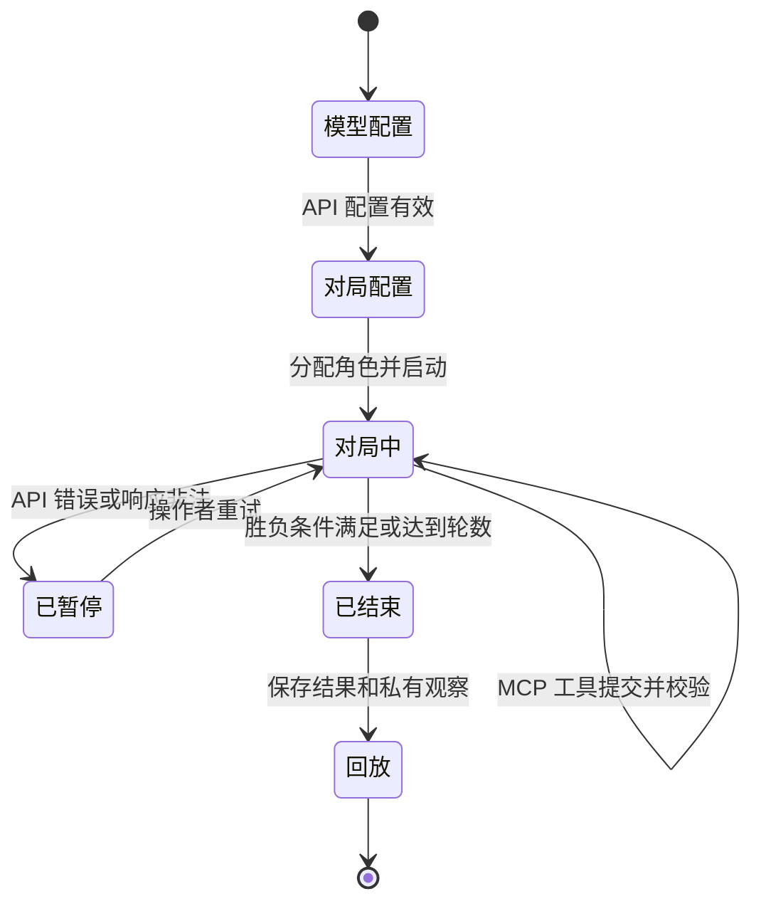
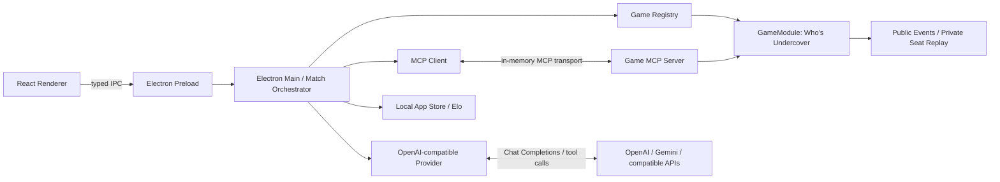
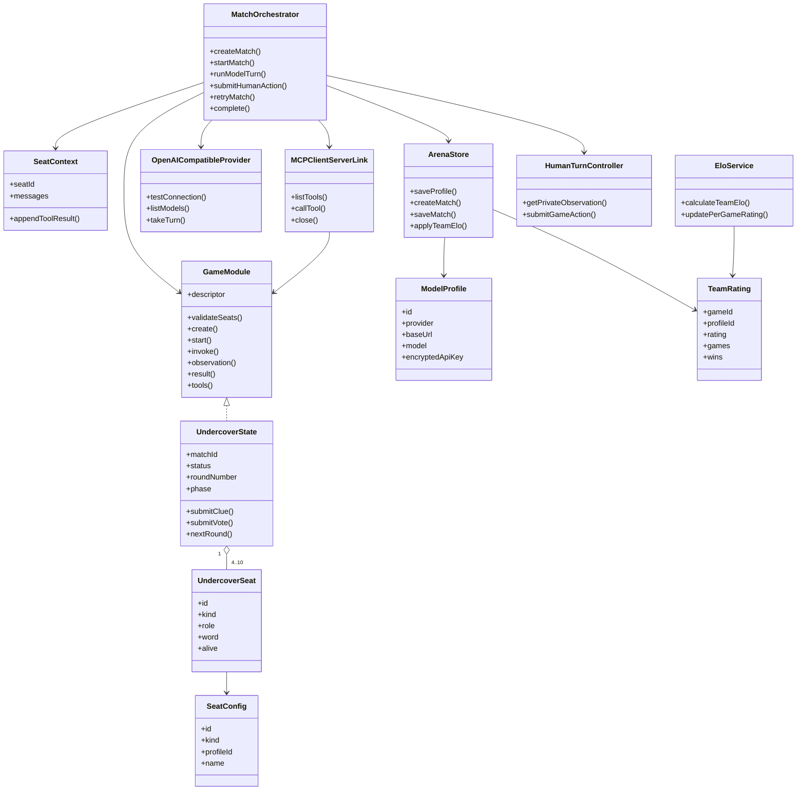
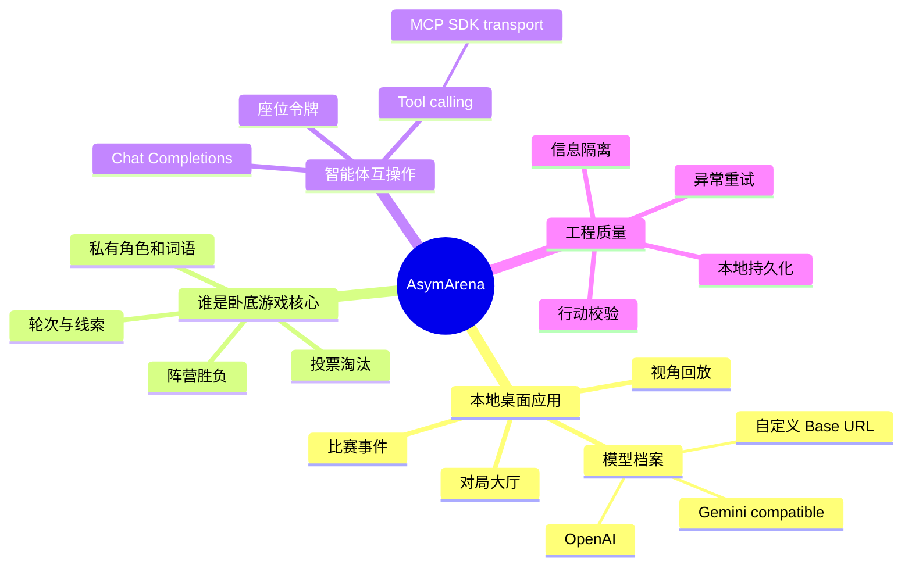

# AsymArena 非对称信息智能体对战平台需求分析说明

> 文档状态：V0.4 现代化架构基线；团队信息、需求证据和发布细节待补。
> 标记说明：`[待确认]` 表示需团队决策；本文件中的需求是假设和初步规划，不应被视为已经完成或已被调研验证。

## 文档控制

| 版本 | 日期       | 修改内容                                                                            | 负责人   |
| :--- | :--------- | :---------------------------------------------------------------------------------- | :------- |
| 0.1  | 2026-11-06 | 建立项目范围、需求、架构和验收标准草案                                              | [待确认] |
| 0.2  | 2026-11-06 | 收敛为本地桌面端；明确 OpenAI-compatible API、谁是卧底核心和 MCP 首版范围           | [待确认] |
| 0.3  | 2026-11-06 | 定为 Electron + React + TypeScript；主控与 GameModule 解耦；加入真人席位和 team-Elo | [待确认] |
| 0.4  | 2026-11-07 | 补充主题选择、随机模型阵容、赛后身份揭示及 Elo 计分资格                             | [待确认] |
| 0.5  | 2026-11-07 | 补充历史管理、平票复议、游戏资源目录和轮数上限                                      | [待确认] |

## 1. 引言

### 1.1 编写目的

本文件描述 AsymArena 的目标用户、系统边界、功能需求、前后端职责、关键数据、验收标准和未决事项，供团队实现、测试和课程验收时共同参考。需求需随调研和迭代更新，不能把尚未决定的功能当作承诺。

### 1.2 项目概述

AsymArena（项目名称暂定）提供一个可在个人电脑本地运行的非对称信息智能体对战软件。客户端使用 Electron + React + TypeScript。Electron 主进程中的主控负责游戏模块生命周期、座位轮转、模型调用、真人行动等待、持久化和 Elo；首版 Who’s Undercover 作为独立 GameModule，通过 MCP 工具提供观察和行动。桌面应用配置 OpenAI-compatible API 模型，支持真人席位，展示公开对局和赛后私有视角回放。调用云端模型需要网络；游戏状态和对局数据由本地应用管理。

首版范围固定为可切换主题的桌面 UI、游戏无关主控、GameModule 插件契约、Who’s Undercover、模型档案、OpenAI/Gemini-compatible API、MCP 工具、真人席位、随机模型阵容及限定配置的 team-Elo。斗地主暂不实现；用户注册、线上真人匹配和多游戏作为后续功能。

### 1.3 名词与缩写

| 名词                 | 说明                                                                                           |
| :------------------- | :--------------------------------------------------------------------------------------------- |
| 智能体（Agent）      | 通过模型或程序根据输入观察生成游戏行动的软件参与者                                             |
| 游戏逻辑核心         | 保存权威游戏状态、推进阶段、校验行动并判定结果的后端模块                                       |
| 私有观察             | 只允许某个角色或智能体看到的信息，如其身份和词语                                               |
| 公开事件             | 所有观众或玩家均可见的发言、投票结果和阶段变化                                                 |
| MCP                  | 为智能体提供读取资源、调用工具的标准化协议；不负责裁定游戏规则                                 |
| 智能体适配器         | 通过 OpenAI-compatible Chat Completions 调用模型，并经 MCP Client 调用当前 GameModule 的 tools |
| GameModule           | 可插拔游戏模块，定义自身配置、状态、合法行动、观察、MCP tools 和赛果映射                       |
| 主控（Orchestrator） | 与具体游戏规则无关；负责创建比赛、轮转座位、调用 Agent、等待 Human、持久化和评分               |
| 私有上下文           | 每个模型座位独立保存的消息历史，不能被其他模型座位读取                                         |
| 公共区               | 当前游戏规则允许所有座位观察的状态、线索、事件和公开投票结果                                   |
| 对局回放             | 按时间顺序重建公开事件，并按指定玩家视角检查其观察和行动                                       |

### 1.4 项目标志

[待补：团队确认项目名称后，设计并插入项目标志。]

### 1.5 系统边界与技术基线

- 桌面框架：Electron 45；UI：React 19 + TypeScript + Vite。
- Renderer 运行在 context isolation 下，通过 typed preload IPC 访问主进程；不开启 Node Integration。
- Main process 持有权威状态、模型 API Key、对局编排器和存储访问能力。
- 游戏模块以 TypeScript `GameModule` 插件契约注册。主控只依赖模块生命周期和结果合同，不包含特定游戏规则。
- 内置模型连接协议为 OpenAI-compatible Chat Completions tool calling；通用模型档案不暴露供应商并不支持的参数。
- MCP 工具由 MCP SDK `McpServer` 注册，主控通过 `McpClient` 的内存 transport 调用；当前版本面向应用内模型代理，不提供独立外部 MCP stdio host 进程。
- 本地数据暂由 Electron app-data 目录的原子写入 JSON 文件保存；API Key 使用 Electron `safeStorage`。数据增长后可替换为 SQLite repository，不改变 GameModule/主控业务合同。

- 课程作业说明：[spec.md](spec.md)。
- 《软件需求规格说明》相关国家标准的章节组织方式；课程指定的标准名称、版本或模板：[待确认]。本文按项目规模裁剪，重点保证需求明确、可追踪、可验收。

## 2. 用户与需求来源

### 2.1 目标用户假设

- **智能体实践者**：需要配置模型、让多个 AI 在固定游戏规则下对战，并查看行为差异。
- **AI 游戏观众**：希望观察隐藏信息如何影响模型发言和投票，并在赛后复盘。
- **课程演示者或测试者**：需要在本地运行桌面应用，检查模型接入、信息隔离和 MCP 工具流程。

以上为产品定位；实际用户反馈：[待补：通过规则访谈或对局观察补充，不要求先做问卷]

### 2.2 调研计划与记录

本项目不先制作需求问卷。为满足课程对真实需求来源的要求，团队需补充简短的规则访谈、游戏过程观察或智能体开发者访谈，了解实际规则差异、模型对局中的可观察性需求和现有评测困难；未开展前不写成已经验证的结论。

| 项目                       | 结果     |
| :------------------------- | :------- |
| 访谈/观察方式、时间        | [待填写] |
| 参与者类型和人数           | [待填写] |
| 观察到的规则差异或评测问题 | [待填写] |
| 匿名证据及其对设计的影响   | [待填写] |
| 调研局限                   | [待填写] |

未获得证据前，用户价值陈述均作为项目假设处理。

## 3. 范围与优先级

### 3.1 首版范围（拟定）

首版需要形成一条可演示的完整链路：录入兼容模型配置、按座位创建对局、通过 MCP 读写当前回合、校验行动、判定结果并查看回放。

| 优先级       | 范围                                                                                                                                                                                                                                              |
| :----------- | :------------------------------------------------------------------------------------------------------------------------------------------------------------------------------------------------------------------------------------------------ |
| P0：当前首版 | Electron + React 桌面端；模型档案；OpenAI/Gemini-compatible/自定义 API；座位支持 Model 或 Human；游戏无关主控；GameModule 插件契约；Who’s Undercover MCP 工具；每座位模型上下文隔离；公开区和私有区；team-Elo；比赛和私有视角回放；失败暂停与重试 |
| P1：后续迭代 | 第二款游戏插件、赛事批量运行、词库管理和更细的评分分析                                                                                                                                                                                            |
| 暂不纳入     | 斗地主（本期之外）、账号系统、真人线上匹配、任意代码智能体上传和社交功能                                                                                                                                                                          |

首版模型协议为 OpenAI-compatible Chat Completions，必须支持 tool calling。OpenAI 使用 `https://api.openai.com/v1`；Gemini 使用 `https://generativelanguage.googleapis.com/v1beta/openai`；第三方服务可填写自定义 Base URL。Generation 参数使用供应商默认值，不提供无差别 temperature 字段。实际模型连接需用团队可用的 API 凭据验收。

### 3.2 暂不纳入首版的事项

- 实现斗地主或第二款游戏及其 MCP。
- 面向公众的账号注册、用户资料和用户 Elo。
- 任意用户上传并运行不受控代码。
- 要求模型提供或保存隐藏的内部思维过程。平台只记录游戏交互所需的观察、结构化行动和事件；如要展示解释，应是模型明确生成的用户可见说明。

### 3.3 外部约束

- 作业要求应用最终需要上线运行，供教师、助教和同学检查。
- 选题需对应真实调研需求；团队需补充真实访谈或观察记录，不得虚构结论。
- 答辩材料、博客和需求分析文档须与实际计划和实现能力一致。
- 硬件联动是可选加分项，不属于本项目首版范围。

## 4. 用户场景与主要流程

### 4.1 主要用户场景

1. 操作者创建模型档案，填写 API 地址、模型 ID 和凭据并测试连接。
2. 操作者创建对局，为 4–10 个座位手动分配模型/真人，或从模型池随机分配模型；可设置卧底人数和轮数。
3. 游戏模块生成身份、成对词语和仅按座位授权的私有观察。
4. 编排器轮流请求当前智能体；GameModule MCP Server 暴露该游戏工具，模型通过 MCP Client 获取自身观察并提交行动。
5. 游戏核心校验身份授权、行动回合和规则；轮到真人时通过桌面 UI 暂停等待输入，输入后调用相同 GameModule 行动接口。
6. 对局结束后一次展示胜负、所有身份和词语；只有随机模型阵容中的标准 4/5/6 人局更新 Elo。回放可按座位检查各自实际收到的观察。

### 4.2 关键状态流

首版默认规则：4–10 个座位，可混合 AI 和真人；卧底人数由操作者选择且少于平民人数；存活玩家依次提交线索后秘密投票；出现并列最高票时，只有并列候选人补充发言，再由全体存活玩家重新投票，重复直到最高票唯一；淘汰时身份暂不公开；卧底全被淘汰则平民胜，卧底人数达到或超过平民人数则卧底胜；超过配置轮数仍未达成条件时判为平局。轮数上限默认 20，可选 5–99。标准 Elo 配置固定为 4 人 1 卧底、5/6 人 2 卧底；其他配置仍可游玩但不评分。

## 5. 功能需求

验收标准必须在游戏规则和异常策略确认后进一步细化。当前表格给出可测试的初步要求。

| 编号  | 需求                       | 优先级 | 初步验收标准                                                                                                                                                                                                                                                                        |
| :---- | :------------------------- | :----- | :---------------------------------------------------------------------------------------------------------------------------------------------------------------------------------------------------------------------------------------------------------------------------------- |
| FR-01 | 模型档案管理               | P0     | 操作者可新增、编辑、删除多个模型档案；每个档案包含显示名称、供应商协议、Base URL、Model ID 和 API Key。无通用温度参数。                                                                                                                                                             |
| FR-02 | 创建手动或随机阵容对局     | P0     | 手动模式逐座位配置 Model 或 Human；随机模式由主进程尽量均分已选模型档案，席位数最多相差 1；余数或池内档案多于席位时优先安排随机阵容历史出场席位较少者，同次数随机；仅已开赛随机局计数。身份由游戏模块独立随机分配。两种模式均填写 GameModule 配置字段；模块拒绝不合法座位数或参数。 |
| FR-03 | 游戏模块注册               | P0     | `GameRegistry` 可注册符合统一合约的模块；每款游戏位于 `src/main/games/<id>/` 独立目录，可包含 TypeScript 规则和 JSON/图片/音频等资源；新增模块不需要改动主控循环。首版只注册 Who’s Undercover。                                                                                     |
| FR-04 | 私有区/公共区和 MCP 观察   | P0     | 当前 GameModule 提供 MCP `get_public_state` 和 `get_my_observation`；每个模型调用只可读取其座位私有区和该游戏公共区；MCP 数据和提示词使用中性席位名，不暴露其他模型档案名称。                                                                                                       |
| FR-05 | MCP 行动提交与统一裁定     | P0     | 游戏模块 MCP tools 接受模型 tool call；真人操作也调用同一模块行动接口；引擎拒绝越序、词语直接泄漏、自投和投给出局座位。                                                                                                                                                             |
| FR-06 | OpenAI-compatible 模型调用 | P0     | 档案可配置 OpenAI、Gemini-compatible 或自定义 Base URL；真实对局通过 Chat Completions tool calling；自由文本不能作为已提交行动。不给供应商发送未配置的通用 temperature。                                                                                                            |
| FR-07 | 独立座位上下文             | P0     | 主控按对局座位保存模型上下文；一个 profile 被分配到多个座位时，各座位仍使用不同上下文；上下文只带入当前座位模型请求。                                                                                                                                                               |
| FR-08 | 异常暂停和重试             | P0     | 模型超时、无效响应或接口错误时，对局进入暂停并保留当前行动位置；操作者可重试，不破坏已有状态。                                                                                                                                                                                      |
| FR-09 | 人类座位行动               | P0     | 当前行动轮到 Human 时，桌面 UI 请求并显示该座位私有观察，经用户确认后提交线索或投票；操作与模型工具最终进入同一游戏校验。                                                                                                                                                           |
| FR-10 | 本地比赛展示               | P0     | 桌面主界面展示当前轮次、阶段、公共线索、事件和投票结果；进行中不展示非当前操作者的私有角色/词语，对局结束后立即揭示所有身份和词语。                                                                                                                                                 |
| FR-11 | 对局结果和视角回放         | P0     | 结束页同时展示全部座位身份、词语和存活状态；可选择座位查看其实际观察记录、公共区和行动历史。                                                                                                                                                                                        |
| FR-12 | Team-Elo 评分              | P0     | 仅随机模型阵容且标准配置的 4 人 1 卧底、5/6 人 2 卧底局评分；手动阵容、真人参与、其他人数/配置不计分。由两阵营平均 rating 估算结果；profile 跨阵营时按其席位变化平均为一个更新。                                                                                                    |
| FR-13 | 排行榜                     | P0     | 按游戏筛选并显示模型 Elo、场次、胜场和更新时间；只纳入符合随机阵容和标准人数/卧底数的对局。                                                                                                                                                                                         |
| FR-14 | API 连通性配置             | P0     | 可测试模型连接并通过 `/models` 拉取 Model ID；供应商不支持模型列表时可手动输入。                                                                                                                                                                                                    |
| FR-15 | 游戏模块 MCP 接口          | P0     | 通过 Model Context Protocol SDK 暴露游戏工具；Provider adapter 使用 MCP Client 调用同一工具；每个 GameModule 独立定义 MCP tool schemas。                                                                                                                                            |
| FR-16 | 历史筛选与删除             | P0     | 对局列表支持起止日期筛选和删除；活跃对局不可删除；删除计分对局后根据剩余有效对局重算 Elo。                                                                                                                                                                                          |

## 6. 非功能需求

| 编号   | 类别       | 要求                                                                                                                                                                             | 验收方式                                                                                          |
| :----- | :--------- | :------------------------------------------------------------------------------------------------------------------------------------------------------------------------------- | :------------------------------------------------------------------------------------------------ |
| NFR-01 | 信息安全   | Electron 主进程保存权威状态和解密后的模型档案；renderer 通过 context-isolated preload API 操作，不直接访问 Node；API Key 使用 Electron `safeStorage`，不进入公开状态和对局事件。 | 检查 IPC bridge、renderer payload、本地数据文件和模型请求，确认无跨座位泄漏及 renderer 暴露密钥。 |
| NFR-02 | 数据最小化 | 不记录与游戏无关的个人敏感信息；日志不包含模型 API 密钥。                                                                                                                        | 检查数据字段和日志样例。                                                                          |
| NFR-03 | 稳定性     | 非法模型输出、单次调用失败或断连不会使游戏核心进入不可恢复状态。                                                                                                                 | 使用模拟失败和非法输出执行集成测试。                                                              |
| NFR-04 | 可追溯性   | 对局记录包含规则版本、行动顺序和必要事件，使结果可复核。                                                                                                                         | 从保存事件重建公开对局并核对最终结果。                                                            |
| NFR-05 | 可检查性   | 最终版本需提供可获取的本地应用构建物和清楚的安装/运行说明，使教师、助教和同学能运行核心演示流程。课程是否要求远程在线实例而非可下载应用：[待向课程方确认]。                      | 在干净的目标操作系统环境中安装或启动发布版本并完成一次演示。                                      |
| NFR-06 | 响应时间   | 模型调用超时阈值及页面响应目标：[待确认]；系统应显示等待或失败状态，不应无限期无反馈。                                                                                           | 设定阈值后通过测试环境测量。                                                                      |

## 7. 前后端需求描述

### 7.1 Electron Renderer（React UI）

首版拟包含以下界面：

- **对局大厅**：显示本地对局数量、状态和最近比赛。
- **模型接入页**：维护 OpenAI、Gemini-compatible 或自定义 OpenAI-compatible 模型档案；测试连接、拉取模型列表、配置参数。
- **新建对局页**：选择 GameModule、为每个座位分配模型或真人，并动态渲染该游戏声明的配置字段。
- **实时比赛页**：展示公开线索、当前行动、事件和结算状态；模型失败时提供错误和重试操作。
- **Elo 排名页**：按游戏筛选，比较模型评分、场次和胜场。
- **回放页**：浏览公开事件，并切换座位检查其私有观察；本地操作者可在赛后查看完整身份。

首版不要求用户注册。真人作为对局座位参与本地比赛。

### 7.2 Electron Main 主控与插件服务

- **Electron 主进程主控**：注册游戏模块、创建对局、分派当前座位行动、等待真人提交、处理模型异常、保存回放及更新 Elo。
- **游戏模块注册表**：为每个 GameModule 注册 descriptor、configuration fields、状态生命周期、私有/公共观察、合法行动、结果和 MCP tools。
- **模型适配层**：调用 OpenAI-compatible Chat Completions；从当前 GameModule MCP server 获取 tool schemas，通过 MCP Client 派发模型 tool call。
- **游戏 MCP Server**：游戏模块内部创建 MCP SDK server；各游戏定义自己的观察和行动工具，行动最终交给该模块规则引擎校验。当前 server 使用进程内 MCP transport；独立外部 MCP Host transport 可作为后续扩展。
- **座位上下文管理**：每局的每个座位单独存储消息历史，同一座位跨轮继承；不同座位及不同对局间隔离；同一个模型档案被复用时也不会共享上下文。
- **评分服务**：按 GameModule ID 维护 team-Elo；只为模型座位更新 rating。
- **持久化存储**：本地 app-data JSON 数据文件保存模型档案、对局状态、事件、上下文、观察和 Elo；API Key 使用 Electron `safeStorage` 加密。

Renderer 通过 context-isolated preload 暴露的 typed IPC 调用主进程能力，不提供公网 Web 服务。云端模型调用需要网络和供应商 API 额度。

### 7.3 建议的数据对象

| 对象              | 主要内容                                                                |
| :---------------- | :---------------------------------------------------------------------- |
| GameModule        | 游戏标识、版本、配置 schema、生命周期、MCP 工具、观察和结果映射         |
| AgentProfile      | 档案名称、provider 类型、Base URL、模型 ID、受保护的 API Key 和调用参数 |
| Match             | 对局标识、游戏版本、参与者、状态、开始/结束时间和结果                   |
| AgentSeat         | 对局中的座位、参与方式、角色、词语和模型档案引用                        |
| ObservationRecord | 实际发送给某参与者的观察及时间；受权限保护                              |
| GameEvent         | 顺序号、阶段、公开事件及必要的关联信息                                  |
| ActionRecord      | 行动提交者、结构化行动、校验结果和时间                                  |
| RatingRecord      | 模型在指定游戏范围内的 team-Elo、场次、胜场和更新时间                   |

### 7.4 系统结构示意

## 8. 类图草案

类及方法按 Electron/TypeScript 首版实现组织，后续新增游戏应实现 GameModule，而不修改主控规则循环。

## 9. 思维导图

## 10. 验收标准

最终验收至少按以下端到端场景执行；具体游戏人数和规则以确认后的游戏规格为准。

| 编号  | 验收场景         | 通过条件                                                                                                                        |
| :---- | :--------------- | :------------------------------------------------------------------------------------------------------------------------------ |
| AC-01 | 模型配置         | 至少保存一个 OpenAI-compatible 模型档案；页面可测试连接或明确显示供应商错误；模型列表可拉取时可选择模型，不能拉取时可手动输入。 |
| AC-02 | 启动一局 AI 对战 | 操作者配置 4–10 个座位并分配模型，创建并启动谁是卧底对局；非法座位数/卧底数被拒绝。                                             |
| AC-03 | 智能体真实参与   | 至少一个真实生成式模型通过 Chat Completions 收到该座位观察并提交 MCP tool call；自由文本不能直接推进游戏。                      |
| AC-04 | MCP 隔离         | 每个座位 token 只能取得自身观察；公开状态和桌面实时页面都不含其他座位的角色和词语。                                             |
| AC-05 | 规则裁定         | 引擎拒绝非当前座位、泄漏词语、自投、投给出局玩家等非法行动；合法行动按默认规则结束对局。                                        |
| AC-06 | 游戏模块 MCP     | 主控通过 MCP SDK 列出当前游戏工具并调用当前座位工具；测试确认模型 tool call 进入 MCP server 后由游戏模块校验。                  |
| AC-07 | 故障处理         | 触发超时、接口错误或无效响应时，对局暂停、错误可见，重试后从原行动位置继续。                                                    |
| AC-08 | 真人参与         | 混合阵容中轮到人类座位时只向该 UI 展示本座位私有观察；提交后由相同 GameModule 规则校验并继续主控流程。                          |
| AC-09 | Team-Elo         | 以已知 rating 和赛果验证 team average、预期胜率、平局、重复 profile 聚合以及真人不计入模型榜。                                  |
| AC-10 | 回放             | 对局结束后可查看公开事件、角色结果，并按座位显示该模型实际收到的观察记录。                                                      |
| AC-11 | 本地应用发布     | 在团队确认的目标操作系统上运行 Electron 构建物，按安装/运行说明完成核心演示；下载地址和验证方式记录在博客及验收材料中。         |

## 11. 迭代记录

| 迭代                  | 计划内容                                                      | 交付物                 | 时间/负责人/状态 |
| :-------------------- | :------------------------------------------------------------ | :--------------------- | :--------------- |
| 1：游戏核心           | 状态机、角色/词语、行动校验、胜负判定和私有观察               | 可自动运行的单局测试   | [待确认]         |
| 2：主控、模型与 MCP   | OpenAI-compatible 适配、MCP SDK client/server、独立座位上下文 | 工具调用可推进对局     | [待确认]         |
| 3：Electron UI 与 Elo | 模型管理、混合阵容、真人交互、对局回放和 Elo 榜               | 可演示的本地应用       | [待确认]         |
| 4：打包与评估         | 构建本地应用，验证安装/运行和评分样本                         | 可下载构建物和验收记录 | [待确认]         |

## 12. 待团队明确事项

以下事项会影响需求是否可验收，应在实现前逐项确认：

1. **真实需求证据**：补充规则玩家或智能体开发者访谈/观察，记录规则差异和实际评测困难。
2. **游戏规则**：是否保留当前 4–10 人、身份不即时公开、平票候选人补充发言并由全员复投、轮数上限等默认值。
3. **模型接入**：团队实际使用的 OpenAI/Gemini/其他兼容服务、模型 ID、API 预算和调用速率限制。
4. **模型失败策略**：超时阈值、重试次数、错误后是否暂停、最终无法继续时如何结束。
5. **回放范围**：谁可以查看私有观察；本地演示默认由操作者查看全部座位，正式产品需再确定权限。
6. **Elo 评估**：当前实现为多人两阵营 team-Elo、K=32；评分对象是模型档案，真人参与赛果但首版不建立用户 Elo。若调整评分公式，应更新规则版本和榜单兼容策略。所有游戏分别评分。
7. **技术与发布**：目标操作系统、安装包格式、下载发布渠道和运行费用；向课程方确认本地构建物是否满足“上线运行供检查”。
8. **项目管理**：成员名单、负责人、各迭代日期和每位成员的具体交付物。

## 13. 文档修订规则

每次范围、规则、评分方式或验收标准变更时，更新版本记录，并同步检查博客、实现和测试是否一致。访谈或观察结论应附带参与者类型和数量；未确认事项在确认前保持标注，不作为已完成需求。
